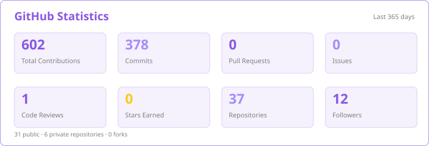
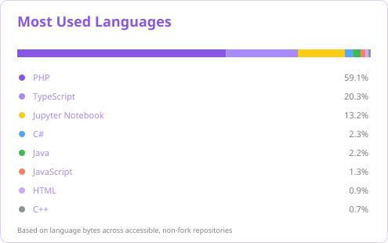
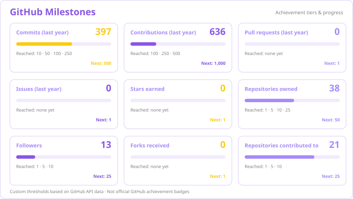
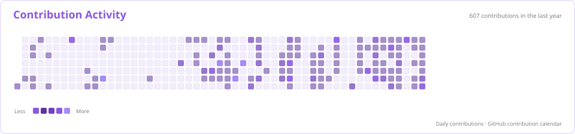

# Self-hosted GitHub profile graphs

## Files

- `.github/workflows/github-graphs.yml` — scheduled workflow.
- `scripts/generate_github_graphs.py` — fetches GitHub GraphQL data and renders four SVGs locally.

## Install

Copy both files into the root of `AlNahianFatin/AlNahianFatin` while preserving their paths.

In the profile repository, ensure the `GH_PAT` Actions secret exists. For private repository data and private contribution counts, use a classic personal access token with `repo` and `read:user` scopes. If you only want public data, a `GITHUB_TOKEN` can be used instead by changing the workflow's `GITHUB_TOKEN` secret expression.

Run **Actions → Generate GitHub Profile Graphs → Run workflow**.

Generated files:

- `profile/stats.svg`
- `profile/top-langs.svg`
- `profile/activity.svg`
- `profile/milestones.svg`

The workflow commits these SVGs to `main`.

## README replacements

Replace the old hosted stats image with:

```html

```

Replace the old hosted top-languages image with:

```html

```

Replace the third-party trophy image with this locally generated metrics card:

```html

```

Replace the activity-graph URL with:

```html

```

Keep the existing streak and snake images as they are.

## Important notes

- These are static SVGs generated in your own workflow. The images are served from your repository; there is no third-party SVG-rendering endpoint.
- The workflow still calls GitHub's own GraphQL API to retrieve your account data.
- The milestones card is based on real repository and contribution metrics. It is **not** a reproduction of GitHub's official profile trophies: GitHub does not currently expose a documented API field for listing those achievement badges.
- The activity chart shows the last 365 days. Language totals are based on accessible, non-fork repositories and their language byte counts.
