# 👋 Hello, I'm Al Nahian Fatin!

  

### 🚀 Building the future, one commit at a time

  

## 🎯 Current Focus

- 🔭 Working on: **Currently exploring new project ideas**
- 🌱 Learning: **Advanced Typescript frameworks**
- 👯 Looking to collaborate on: **Open Source Projects involving software and web development**
- 💬 Ask me about: **C#, Software Development, HTML, CSS, JavaScript, Typescript, Web Development, and Project Ideas**
- ⚡ Fun fact: **I enjoy exploring new technologies and love problem-solving**

---

## 🛠️ Technology Arsenal

### 💻 Programming Languages

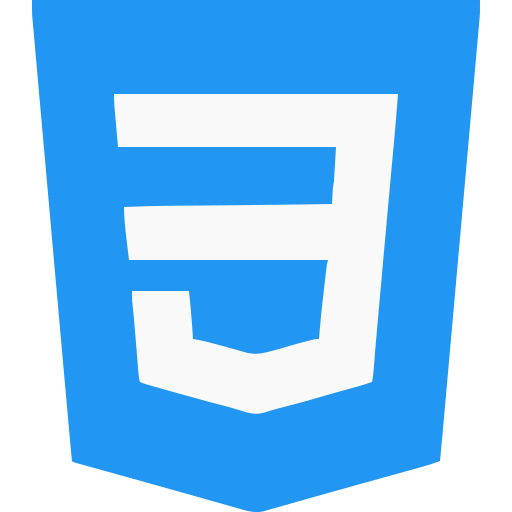

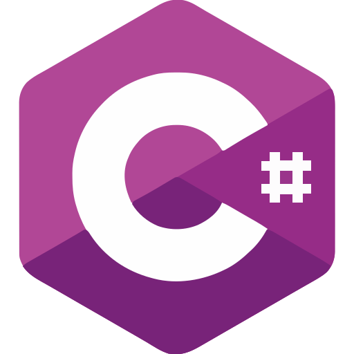

### 🚀 Frameworks & Libraries

### ☁️ Tools & Development

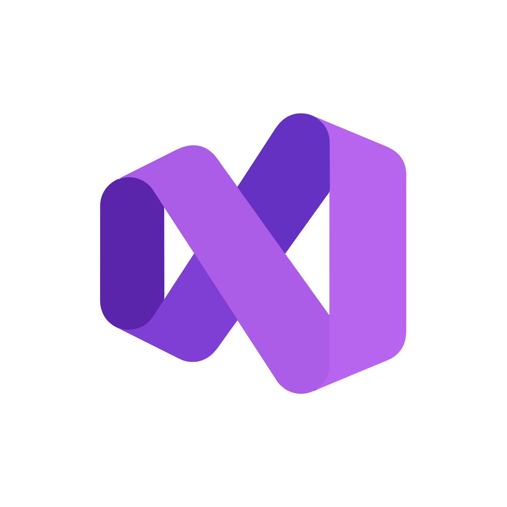

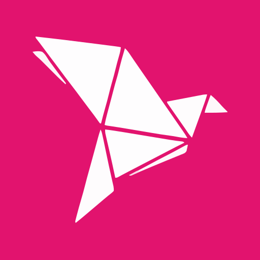

### 🗄️ Databases

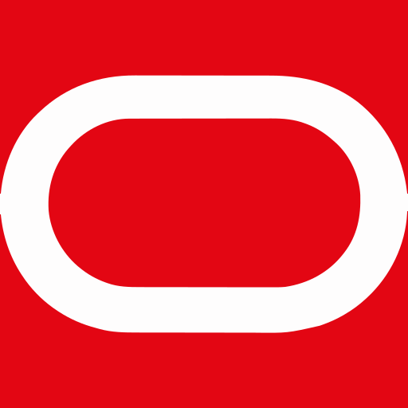

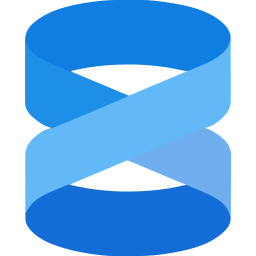

---

## 📊 GitHub Statistics

<!-- 

 -->

  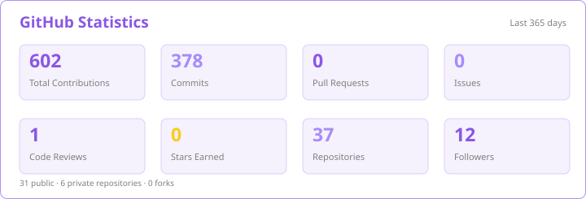

  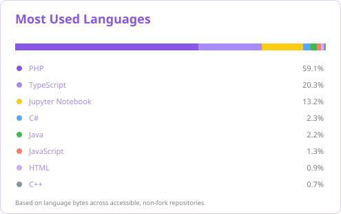

---

## 🏆 GitHub Achievements

<!--  -->

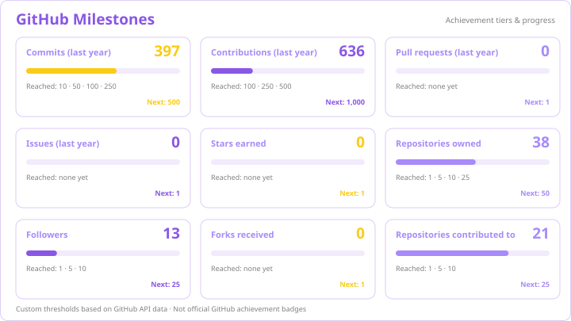

---

## 📈 Contribution Activity

<!--  -->

 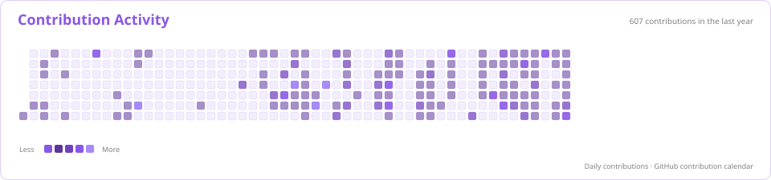

---

## 🔥 Contribution Streak

  

---

## 🐍 Contribution Snake

<picture>
  <source media="(prefers-color-scheme: dark)" srcset="https://raw.githubusercontent.com/AlNahianFatin/AlNahianFatin/output/github-snake-dark.svg">
  <source media="(prefers-color-scheme: light)" srcset="https://raw.githubusercontent.com/AlNahianFatin/AlNahianFatin/output/github-snake.svg">
  
</picture>

---

## 🏗️ Featured Projects

### 🚀 Gamers United

A full-stack gaming community platform.

---

## 🌐 Let's Connect & Collaborate

---

## 📱 Social Presence

---

  

### 🚀 "Code is poetry, and every commit tells a story"

⭐ Feel free to star any repositories you find interesting!

